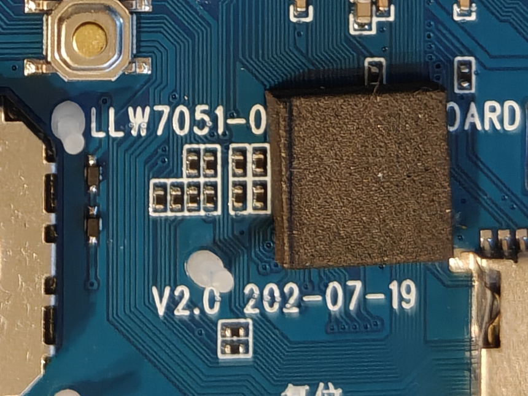

# XGB35 hardware

**EN** · [RU](hardware.ru.md)

These measurements describe one physical XGB35 unit. Retail listings and firmware profiles can differ across revisions.

| Component | Specification | Evidence |
| --- | --- | --- |
| Console | **XGB35**, 3.5-inch display class | [Wiisun catalog](https://www.game-gaga.com/xgb35-handheld-game-console-support-for-music-videos-picture-text-reading-3-5-inch-ips-screen-linux-handheld-game-player-product/) |
| Main board | **LLW7051-057-MAIN-BOARD V2.0**, dated **2022-07-19** | [Board marking](../photos/board-detail.png) |
| SoC | **Actions Semiconductor ATM7051H**, Actions OWL / ATS3605, 32-bit ARMv7-A | BootROM ADFU and Linux 3.10.52. The diagnostic boot used `maxcpus=1`, so it established a single active CPU for that session |
| RAM | **At least 128 MiB** of addressable DDR | A reversible alias test sampled distinct addresses up to physical `0x07fff000`. Linux ran with a `0x00000000–0x07ffffff` memory map. The upper physical limit remains unmeasured |
| Internal storage | **Micron MT29F64G08CBABA WP:B**, **64 Gbit / 8 GiB**, raw MLC NAND | [Package photo](../photos/nand-detail.png), observed ID `2c 64 44 4b a9`, [Micron data sheet](https://datasheet.lcsc.com/lcsc/1908271118_Micron-Tech-MT29F64G08CBABAWP-B_C410865.pdf) |
| LCD | **XXL03518B** flex marking. **320×480 RGB565** framebuffer, rotated 90° for a **480×320** landscape interface | On-device framebuffer terminal. The initialization sequence is consistent with the ST7796S family. An independent controller-ID read did not confirm the exact chip. [Sitronix data sheet](https://dl.espressif.com/dl/schematics/ST7796S_SPEC_V1.0.pdf) |
| LCD interface | Parallel RGB pixels, SPI LCD commands, GPIOB6 and PWM0 for panel power and backlight | RAM-side register and display tests |
| PMIC | **Actions ATC2603C**, I²C address `0x65` | Device tree, PMIC transactions and Linux log |
| Battery | **XY 604050**, **3.7 V**, **2,000 mAh**, **7.4 Wh** | [Battery and PCB photo](../photos/board-back.png) |
| USB | USB-C; BootROM ADFU `10d6:10d6`; diagnostic ADB over WinUSB and a RAM-backed Mass Storage test | USB enumeration and transfer tests |
| Removable storage | microSD / TF | [Slot photo](../photos/sd-close.png). The autonomous microSD boot image passed offline checks. Cold boot still needs confirmation |
| Controls | D-pad, dual sticks, ABXY, shoulder buttons and function buttons | Catalog photo and diagnostic terminal input code |
| Audio and external display | Internal speaker, 3.5 mm jack and digital video output listed for XGB35 | Speaker seen on the unit. The diagnostic build did not verify external video. [Wiisun catalog](https://www.game-gaga.com/xgb35-handheld-game-console-support-for-music-videos-picture-text-reading-3-5-inch-ips-screen-linux-handheld-game-player-product/) |
| UART | Linux device tree selects `ttyS5` at **115200 8N1** | Linux registered UART5. The pad pinout and reliable capture on this unit remain unverified. [Pad area photo](../photos/console-uart-pads.png) |

## Display profiles

The working interface presents a 480×320 landscape screen through a 320×480 portrait framebuffer. XGB35 listings also mention 480×272 and 640×480. The older NAND U-Boot and MISC package selects a 1024×600 profile. Confirm display geometry against the panel and runtime output before installing a flash image. [LZAKMR listing](https://manuals.plus/ae/1005006855426011) · [FAITDER listing](https://manuals.plus/asin/B0DG8FCK92)

## NAND geometry and logical partitions

A physical page contains **8,192 data bytes + 744 OOB bytes**. An erase block contains **256 pages**. Raw NAND recovery uses OOB markers and ECC. Logical Linux partition images are read through the FTL. The stock OTA container carries logical partition images and a dedicated bootloader record. [Micron NAND geometry](https://datasheet.lcsc.com/lcsc/1908271118_Micron-Tech-MT29F64G08CBABAWP-B_C410865.pdf)

| Device | Partition | Observed role |
| --- | --- | --- |
| `/dev/nand0p1` | MISC | 8 MiB FAT volume with kernel, DTB, ramdisk and boot parameters |
| `/dev/nand0p2` | RECOVERY | 10 MiB FAT volume with recovery initramfs and stock updater |
| `/dev/nand0p3` | CONFIG | 128 KiB of device configuration |
| `/dev/nand0p4` | SYSTEM | 40 MiB partition with the stock SquashFS and `manager` |
| `/dev/nand0p5` | UPGRADE | 5 MiB FAT update partition |
| `/dev/nand0p6` | RES | 40 MiB partition with SquashFS interface resources |
| `/dev/nand0p8` | UDISK | About 4.82 GiB, FAT32, label **GAME** |

A live NAND status read returned `0xE0`, which indicates that hardware write protection was inactive. The Mass Storage experiment exported a RAM-backed test volume. Exporting **GAME** read-only still requires checking the NAND driver's initialization behavior.

## Boot and diagnostics

The stock boot path runs BootROM, the early NAND loader, U-Boot and Linux. ADFU allowed a diagnostic SRAM program to initialize DDR and boot Linux from RAM. Once ADB over WinUSB was available, commands and files could be transferred without UART. An XGB35 RAM utility named `reboot-adfu` was prepared for returning to ADFU from a running Linux session.

## Photos of the tested unit

| Photo | Detail |
| --- | --- |
| [Battery side of the board](../photos/board-back.png) | Battery, button contacts, LCD connector and labeled rails |
| [Board revision](../photos/board-detail.png) | V2.0 marking and date |
| [Micron NAND](../photos/nand-detail.png) | NAND package marking |
| [ADFU inspection area](../photos/adfu-close.png) | Area used during low-level diagnostics |
| [microSD slot](../photos/sd-close.png) | Slot and adjacent pads |
| [UART pad area](../photos/console-uart-pads.png) | Close-up for comparison against the physical board |
