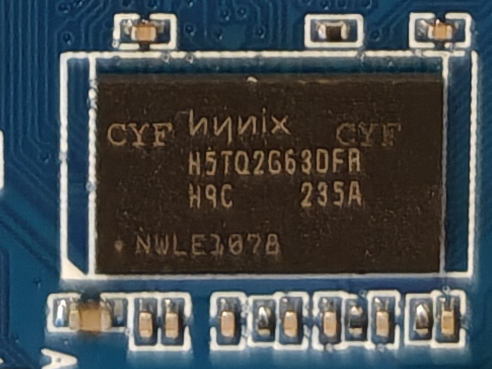
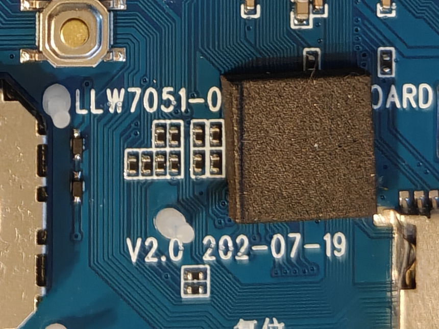

# Железо XGB35

[EN](hardware.md) · **RU**

Измерения относятся к одному экземпляру XGB35. Характеристики в карточках продавцов и настройки прошивок могут различаться между ревизиями.

| Узел | Характеристика | Подтверждение |
| --- | --- | --- |
| Приставка | **XGB35**, экран 3,5″ | [Каталог Wiisun](https://www.game-gaga.com/xgb35-handheld-game-console-support-for-music-videos-picture-text-reading-3-5-inch-ips-screen-linux-handheld-game-player-product/) |
| Основная плата | **LLW7051-057-MAIN-BOARD V2.0**, дата **2022-07-19** | [Фото маркировки](../photos/board-detail.png) |
| SoC | **Actions Semiconductor ATM7051H**, семейство Actions OWL / ATS3605, 32-битная ARMv7-A | BootROM ADFU и Linux 3.10.52. Диагностическая сборка запускалась с `maxcpus=1`, поэтому в сеансе было активно одно ядро |
| Оперативная память | **256 МиБ DDR3**, SK hynix **H5TQ2G63DFR-H9C**, шина x16 | [Маркировка на фото](../photos/ddr-marking.png) · [Даташит SK hynix](https://www.unikeyic.com/media/datasheet/8b/06/108a/8b/01b4e312316605b5dbbeedfd3ef68ae2.pdf) |
| Внутренняя память | **Micron MT29F64G08CBABA WP:B**, **64 Гбит / 8 ГиБ**, сырая MLC NAND | [Фото микросхемы](../photos/nand-detail.png), считанный ID `2c 64 44 4b a9`, [даташит Micron](https://datasheet.lcsc.com/lcsc/1908271118_Micron-Tech-MT29F64G08CBABAWP-B_C410865.pdf) |
| LCD | Шлейф **XXL03518B**. Framebuffer **320×480 RGB565**, поворот на 90° для горизонтального интерфейса **480×320** | Терминал на экране приставки. Последовательность инициализации соответствует семейству ST7796S. Точную модель контроллера чтением ID подтвердить не удалось. [Даташит Sitronix](https://dl.espressif.com/dl/schematics/ST7796S_SPEC_V1.0.pdf) |
| Интерфейс LCD | Параллельный RGB для пикселей, SPI для команд панели, GPIOB6 и PWM0 для питания панели и подсветки | Тесты регистров и изображения при запуске из RAM |
| PMIC | **Actions ATC2603C**, адрес I²C `0x65` | Дерево устройств, обмен с PMIC и журнал Linux |
| Аккумулятор | **XY 604050**, **3,7 В**, **2000 мА·ч**, **7,4 Вт·ч** | [Фото аккумулятора и платы](../photos/board-back.png) |
| USB | USB-C, BootROM ADFU `10d6:10d6`, диагностический ADB через WinUSB и тест USB Mass Storage с томом из RAM | Устройство определилось по USB и передавало данные |
| Съёмная память | microSD / TF | [Фото разъёма](../photos/sd-close.png). Образ для автономной загрузки прошёл проверку на ПК. Холодный старт с карты ещё предстоит подтвердить |
| Управление | Крестовина, два стика, ABXY, плечевые и служебные кнопки | Каталожное фото и обработка ввода в диагностическом терминале |
| Звук и внешний экран | Для XGB35 заявлены встроенный динамик, разъём 3,5 мм и цифровой видеовыход | Динамик виден в разобранном экземпляре. Внешний видеовыход в диагностической сборке не проверялся. [Каталог Wiisun](https://www.game-gaga.com/xgb35-handheld-game-console-support-for-music-videos-picture-text-reading-3-5-inch-ips-screen-linux-handheld-game-player-product/) |
| UART | Дерево устройств Linux выбирает `ttyS5` с параметрами **115200 8N1** | Linux зарегистрировал UART5. Распиновка и стабильный приём журнала на этом экземпляре ещё не подтверждены. [Фото площадок](../photos/console-uart-pads.png) |

## Оперативная память

На проверенном экземпляре с платой **LLW7051-057-MAIN-BOARD V2.0** от **2022-07-19** установлена микросхема **H5TQ2G63DFR-H9C**. Её ёмкость по даташиту составляет 2 Гбит (128M × 16), то есть **256 МиБ**. Число 128 МиБ в ранних записях относится к карте памяти диагностической сборки Linux. В том сеансе проверка адресации охватывала адреса до `0x07fff000`.

## Режимы экрана

Рабочий интерфейс 480×320 выводится через портретный framebuffer 320×480. В карточках XGB35 также встречаются 480×272 и 640×480. В старых образах U-Boot и MISC из NAND выбран профиль 1024×600. Перед установкой образа сверяйте геометрию с панелью и фактическим выводом. [Карточка LZAKMR](https://manuals.plus/ae/1005006855426011) · [Карточка FAITDER](https://manuals.plus/asin/B0DG8FCK92)

## Геометрия NAND и логические разделы

Физическая страница содержит **8192 байта данных и 744 байта OOB**. В блоке стирания **256 страниц**. При восстановлении сырой NAND используются маркеры OOB и ECC. Логические разделы Linux читаются через FTL. Штатный контейнер OTA содержит образы логических разделов и отдельную запись загрузчика. [Геометрия NAND в даташите Micron](https://datasheet.lcsc.com/lcsc/1908271118_Micron-Tech-MT29F64G08CBABAWP-B_C410865.pdf)

| Устройство | Раздел | Назначение |
| --- | --- | --- |
| `/dev/nand0p1` | MISC | FAT, 8 МиБ. Ядро, DTB, ramdisk и параметры загрузки |
| `/dev/nand0p2` | RECOVERY | FAT, 10 МиБ. Initramfs режима восстановления и штатный обновлятор |
| `/dev/nand0p3` | CONFIG | 128 КиБ настроек устройства |
| `/dev/nand0p4` | SYSTEM | Раздел на 40 МиБ со штатным SquashFS и программой `manager` |
| `/dev/nand0p5` | UPGRADE | FAT, 5 МиБ. Раздел обновления |
| `/dev/nand0p6` | RES | Раздел на 40 МиБ с ресурсами интерфейса в SquashFS |
| `/dev/nand0p8` | UDISK | Около 4,82 ГиБ, FAT32, метка **GAME** |

Приставка вернула статус NAND `0xE0`. Аппаратная защита от записи была выключена. В эксперименте с USB Mass Storage использовался тестовый том в RAM. Для экспорта **GAME** только на чтение ещё нужно проверить поведение NAND-драйвера при запуске.

## Загрузка и диагностика

Штатная цепочка проходит через BootROM, ранний загрузчик NAND, U-Boot и Linux. Через ADFU диагностическая программа из SRAM инициализировала DDR и запустила Linux из RAM. После запуска ADB через WinUSB появилась возможность передавать файлы и выполнять команды без UART. Для возврата из работающего Linux в ADFU подготовлена утилита `reboot-adfu`.

## Фотографии проверенного экземпляра

| Фото | Что видно |
| --- | --- |
| [Плата со стороны аккумулятора](../photos/board-back.png) | Аккумулятор, контакты кнопок, разъём LCD и подписанные линии питания |
| [Ревизия платы](../photos/board-detail.png) | Маркировка V2.0 и дата |
| [NAND Micron](../photos/nand-detail.png) | Маркировка микросхемы NAND |
| [Область ADFU](../photos/adfu-close.png) | Область платы, использованная при низкоуровневой диагностике |
| [Разъём microSD](../photos/sd-close.png) | Разъём и соседние площадки |
| [Область UART](../photos/console-uart-pads.png) | Крупный план для сверки с физической платой |
